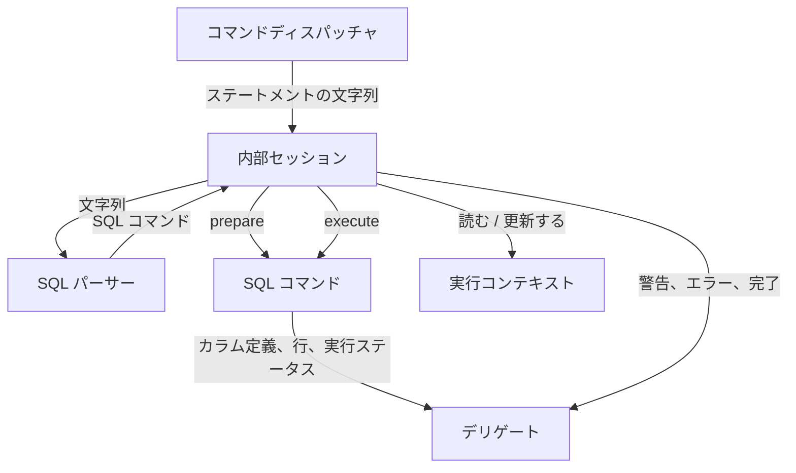
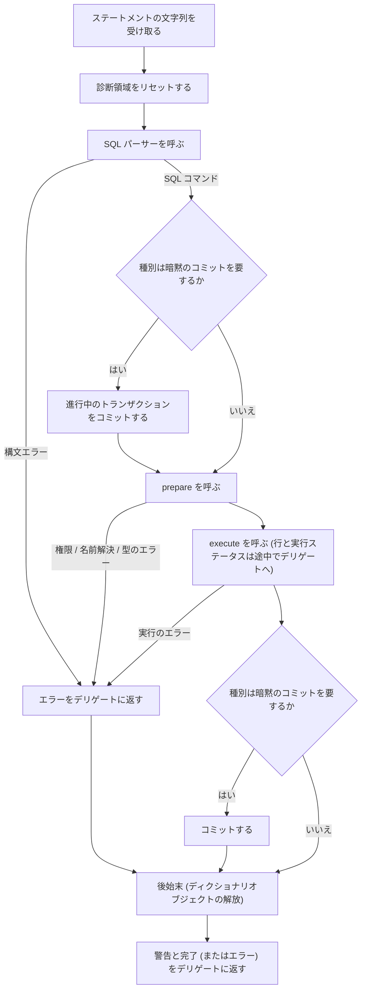

# 内部セッション

- コマンドディスパッチャから受け取ったステートメントを、SQL パーサー → SQL コマンドのプリペア → SQL コマンドの実行の順に処理する部分の仕様
- 結果とエラーはデリゲートに返す
- ステートメントの処理に必要な状態 (実行ユーザー、デフォルトスキーマ、トランザクションの状態など) は内部セッションが持つ

## 責務

### 担うこと

- ステートメントの処理: 文字列を SQL パーサーに渡し、返った SQL コマンドをプリペアしてから実行する
- 実行コンテキストの保持: 実行ユーザーとグローバル権限、デフォルトスキーマ、進行中のトランザクションの状態、診断領域 (`diagnostics_area`)、kill を要求されているかどうかの状態を持つ
- 暗黙のコミット: DDL、アカウント管理ステートメント、`GRANT` / `REVOKE` の前後と、`BEGIN` / `START TRANSACTION` の前で、進行中のトランザクションをコミットする
- 結果の受け渡し: カラム定義、行、実行ステータス、警告、エラーをデリゲートに渡す
- ステートメントの終わりの後始末: 取得したディクショナリオブジェクト (`prepare` で名前解決のために取った、テーブルなどの定義のメモリ上の表現) を解放し、診断領域をリセットする
- セッションの終わりの後始末: 進行中のトランザクションをロールバックし、保持している資源を解放する

### 担わないこと

- セッション変数、ユーザー変数、一時テーブル、ストアドプログラムの状態: 持たない
  - `autocommit` も変えられず、常に有効
- classic protocol のコマンド (`COM_QUERY` など) の受け口: 持たない

## 構成要素

- 実行コンテキスト: 実行ユーザー (グローバル権限を含む)、デフォルトスキーマ、トランザクションの状態、診断領域、kill を要求されているかどうかの状態
- SQL コマンド: SQL パーサーの出力で、ステートメント 1 つに対するプリペアと実行を行うもの (内部セッションはこれを呼ぶ側)
- デリゲート: 結果の受け口 (コマンドディスパッチャの構成要素で、内部セッションはこれに渡す側)
- ディクショナリクライアント: データディクショナリから定義を取得する操作 (データディクショナリの構成要素で、内部セッションごとに 1 つ持つ)

### 実行コンテキスト

- MySQL での仕様
  - 接続ごとに 1 つあり、その接続で実行する全てのステートメントが共有する
  - 実行ユーザー: 認証の成功時に確定し、権限の検査に使う
  - デフォルトスキーマ: 接続時に決まり、`USE` で切り替わり、修飾のないテーブル名の解決に使う
  - トランザクションの状態: 進行中かどうかと、その開始の仕方
  - 診断領域 (Diagnostics Area): 現在のステートメントのエラー (1 つ) と警告 (並び) の記録で、ステートメントごとにリセットする
  - kill の要求: 他の接続からの `KILL` や管理コマンドで立ち、実行中のステートメントが確認点 (行を読むたび、行を送るたび) で確認して中断する
- MineSQL 特有の仕様
  - 実行ユーザーが持つのは名前とグローバル権限
    - MySQL はこれに加えてホスト、プロキシユーザー、有効なロールを持つ
  - トランザクションの状態は「なし」「進行中」の 2 つと、`WITH CONSISTENT SNAPSHOT` で始めたかどうか
    - 「進行中」になるのは `BEGIN` / `START TRANSACTION` で始めたときだけ (`autocommit` は常に有効で、`SET` でもサーバーの設定でも変えられない)
    - MySQL は `autocommit=0` による暗黙の開始も「進行中」に含め、開始の仕方に `READ ONLY` / `READ WRITE` も持つ
  - kill の要求は接続を閉じる要求だけ (`KILL CONNECTION`)
    - MySQL はこれに加えて `KILL QUERY` (ステートメントだけを止める) とタイムアウトによる中断を持つ

### SQL コマンドの 2 つの操作

- MySQL での仕様
  - 入口は `prepare` と `execute` を順に呼ぶだけで、種別で分岐しない
  - `execute` の中身は種別ごとに違い、次の表のとおり

| 種別 | `execute` の中身 | 関わるモジュール |
| --- | --- | --- |
| SELECT / INSERT / UPDATE / DELETE | オプティマイザが実行計画を選び、エグゼキュータがそれを実行してストレージエンジンを読み書きし、行と実行ステータスを返す | オプティマイザ、エグゼキュータ、ストレージエンジン |
| CREATE TABLE / DROP TABLE / CREATE SCHEMA / DROP SCHEMA | 定義を検証し、データディクショナリの定義の変更とストレージエンジンのテーブルの作成・削除を原子的に行う | データディクショナリ、ストレージエンジン |
| USE | スキーマの存在を確認し、デフォルトスキーマを切り替える | 内部セッション、データディクショナリ |
| トランザクション制御 | トランザクションを開始・確定・取り消し、実行コンテキストの状態を更新する | 内部セッション、ストレージエンジン |
| アカウント管理ステートメント、GRANT / REVOKE | `minesql.user` の行を変更し、SHA256 パスワードキャッシュのエントリを消す | ACL |
| KILL | 対象の接続に kill の要求を立て、接続を閉じる | コネクションハンドラー |

### 診断領域 (Diagnostics Area)

- MySQL での仕様
  - エラーが 1 つ起きた時点でステートメントを打ち切るので、持つエラーは最大 1 つ
  - 警告は打ち切らずに診断領域に溜め、ステートメントの終わりにまとめて取り出す
  - 診断領域は入れ子にできる (ストアドプログラムや内部で実行する補助のステートメントが、外側の診断領域を汚さずに自分の結果を持つため)
  - 溜めた警告は `SHOW WARNINGS` / `GET DIAGNOSTICS` で SQL から読め、`max_error_count` を超えた分は件数だけ数える
- MineSQL 特有の仕様
  - 診断領域は 1 つだけで、入れ子にしない
    - 入れ子が必要になるのは 1 つのステートメントの中で別のステートメントが動くときで、MineSQL はストアドプログラムとトリガーを持たないのでその場面がないため
    - 認証で `minesql.user` を読む SELECT も内部セッションで実行し、その結果は同じ診断領域に入るが、入れ子にしなくても混ざらないため
      - MySQL ではこの SELECT がクライアントのステートメントの処理中にも走りうるので、入れ子にして結果が混ざらないようにする
      - MineSQL ではこの SELECT をクライアントのステートメントを受け付ける前の段階でだけ実行するので、他のステートメントの処理と混ざらない
  - 警告を SQL から読む手段は持たず、ステートメントの終わりにまとめてデリゲートへ渡すだけ
  - 件数の上限を持たない

## 処理の流れ

ステートメントの文字列を 1 つ受け取ってから、完了をデリゲートに返すまでの流れ

- 暗黙のコミットを要する種別は以下
  - DDL
  - アカウント管理ステートメント
  - `GRANT` / `REVOKE` (前後の両方)
  - `BEGIN` / `START TRANSACTION` (前だけ。後にもコミットすると始めたばかりのトランザクションが終わってしまうため)
- エラーはどの段階のものもステートメント単位で、セッションは継続する
- kill の要求があれば、実行中の処理は確認時点で中断し、その後は接続が閉じられる
- 実行結果は溜めずに、できた順にデリゲートへ渡す
  - デリゲートも溜めず、受け取るたびにプロトコルのメッセージにしてクライアントへ送るので、サーバーのどこにもリザルトセット全体は溜まらない
  - 例: SELECT の場合、エグゼキュータが最初にカラム定義をまとめて渡し、その後は行を 1 行取り出すたびに渡す
    - 全行を渡し終えたら、内部セッションが警告と完了を渡す

## MySQL の設計の要点

### X Plugin と内部セッションの境界

- MySQL の内部セッションは SQL の文字列ではなく classic protocol のコマンドを受け取り、処理は「コマンドの受付」と「ステートメントの実行」の 2 段になっている
- コマンドの受付: コマンドの種別を `switch` で振り分ける段
  - コマンドには SQL の実行 (`COM_QUERY`) のほかに、デフォルトスキーマの変更 (`COM_INIT_DB`)、セッションのリセット (`COM_RESET_CONNECTION`)、生存確認 (`COM_PING`) など 26 種類がある
  - `COM_QUERY` のときだけ診断領域をリセットして文字列を解析し、ステートメントの実行の段へ進む
  - X Plugin は受け付けた SQL の文字列を毎回 `COM_QUERY` に包んでこの段に渡す
- ステートメントの実行: 暗黙のコミットを判定してから実行する段
  - SQL コマンドを持つステートメントは、その `execute` を呼ぶ
  - 持たない古い形のステートメント (`KILL`、`BEGIN`、`COMMIT`、`CREATE USER` など) は、`execute` ではなく、種別ごとの分岐に応じて処理を呼ぶ
- MineSQL との違いは 2 つ
  - MineSQL の場合、内部セッションは SQL の文字列だけを受け取るので、コマンドを振り分ける必要がない
    - セッションのリセットなど、SQL で表せない操作はディスパッチャやコネクションハンドラーが**内部セッションを介さずに**行う
  - 全てのステートメントを SQL コマンドにするので、常に `prepare` → `execute` の流れで実行される

### 実行コンテキストが持つもの

- MySQL の実行コンテキスト (THD) が持つ主なもの
  - 実行ユーザー (セキュリティコンテキスト)、デフォルトスキーマ、トランザクションの状態、診断領域、kill の状態
  - セッション変数、ユーザー変数、一時テーブル、ストアドプログラムの実行状態
- MineSQL が持つのは前者の 5 つだけで、後者は対象外の機能なので持たない
- 暗黙のコミットをするかどうかは、ステートメントの実行の段が、ステートメントの実行前に、種別ごとのフラグ (前でコミットするか、後でコミットするか) を見て判定する
- `KILL` は対象の内部セッションを直ちに止めるのではなく、kill を要求されたという状態を記録するだけで、実行中の処理がその状態を確認点で読んで自分から中断する

## 参考資料

- [MySQL 8.4 Reference Manual: 15.3.3 Statements That Cause an Implicit Commit](https://dev.mysql.com/doc/refman/8.4/en/implicit-commit.html)
- [MySQL 8.4 Reference Manual: 15.7.8.4 KILL Statement](https://dev.mysql.com/doc/refman/8.4/en/kill.html)
