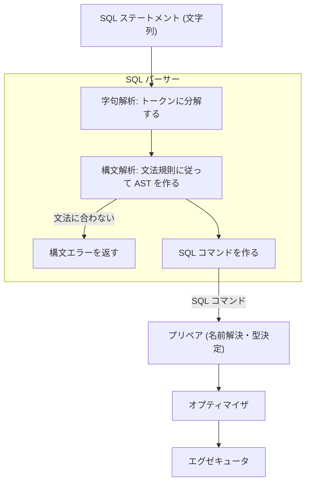
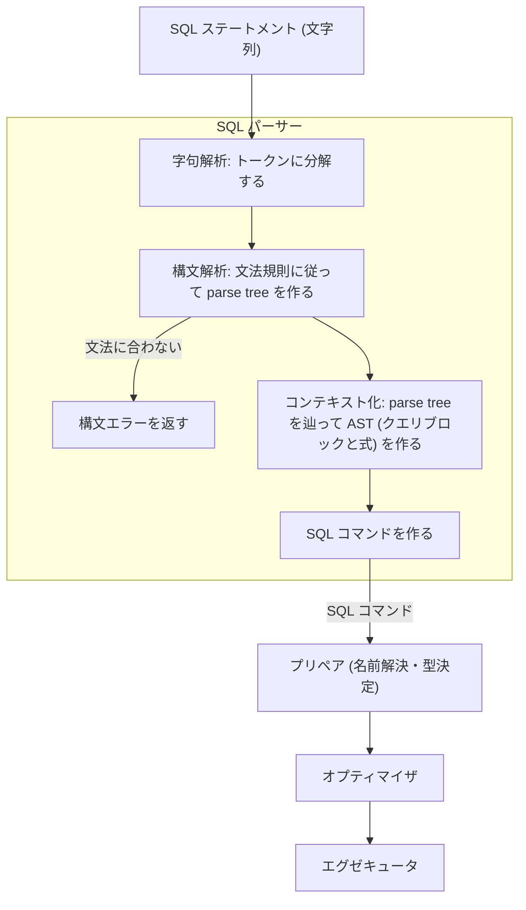

# SQL パーサー

- ステートメントの文字列を受け取り、AST を持つ SQL コマンドに変える部分の仕様

## 責務

### 担うこと

- 字句解析: ステートメントの文字列をトークン (キーワード、識別子、リテラル、記号) に分解する
- 構文解析: 字句解析で得られたトークンの列を受け取り、文法規則に従っているかを確認し、句 (clause: `SELECT` / `FROM` / `WHERE` などのステートメントの部分) ごとに組んだ AST (未解決のクエリブロックと式) を作る
  - 同義語 (`<>` と `!=`、`JOIN` と `INNER JOIN` など) は同じトークン・同じノードにする
- 構文エラーの報告: 文法に合わない入力に対して、文法に合わなくなった箇所 (行番号とその箇所からの抜粋) を含むエラーを返す
- SQL コマンドの生成: ステートメントの種別に対応する SQL コマンド (AST を含む) を作る

## 構成要素

- 字句解析器 (lexer): 入力の文字列と読み取り位置を持ち、構文解析器から要求されるたびに次のトークンを 1 つ切り出して返す
  - キーワードと識別子の区別はキーワード表で行う
- 構文解析器 (parser): 字句解析器からトークンを 1 つずつ受け取り、文法規則に従って AST を組み立てる
  - 文法に合わない入力には構文エラーを返す
- AST: 構文解析の結果であり、句ごとに組んだ未解決のクエリブロックと式を表す
  - クエリブロックは 1 つの SELECT に対応する単位で、select list、FROM のテーブル一覧、WHERE の条件、ORDER BY、LIMIT をまとめて持つ (INSERT や UPDATE も、値や条件を持つ 1 つのクエリブロックとして表す)
  - 未解決とは、名前がどのテーブル・どのカラムを指すかと、式の型がまだ決まっていない状態
  - プリペアが同じノードに解決結果を書き込み、オプティマイザとエグゼキュータも同じノードを使う
- SQL コマンド (Sql_cmd): ステートメント 1 つに対してプリペアと実行を行うもので、種別 (SELECT、INSERT、CREATE TABLE など) ごとに種類がある
  - パーサーが種別に合う SQL コマンド (AST を含む) を作る
  - 例: `SELECT name FROM users WHERE id = 1` からは、次のような SELECT 用の SQL コマンドができる

    ```text
    SQL コマンド (SELECT)
      AST:
        select list: [name]
        FROM:        [users]
        WHERE:       id = 1
    ```

  - 例: `CREATE TABLE users (id INT, name VARCHAR(20))` からは、テーブルの定義を持つ CREATE TABLE 用の SQL コマンドができる

    ```text
    SQL コマンド (CREATE TABLE)
      テーブルの定義: users (id INT, name VARCHAR(20))
    ```

## 処理の流れ



## MySQL の設計の要点

### MySQL のパーサーの構成要素

- 字句解析器: 手書きで、Bison (パーサージェネレーターの一種) が生成した構文解析器から呼ばれる
- 構文解析器: Bison の LALR(1) 文法 (左から読み、1 トークンの先読みで規則を決める方式) から生成される
- parse tree: ステートメントの構造をそのまま写した一時的なツリー構造のデータ (構文解析器はこれを出力する)
  - コンテキストに依存しない
    - parse tree を作る時点では、テーブルの定義も接続ごとの設定 (デフォルトスキーマなど) も見ない
  - 各ノードは、与えられたコンテキスト (今どのクエリブロックの中か など) をもとに、自分に対応する AST のノードを作る (この処理をコンテキスト化と呼ぶ)
  - ルートノードは、まず子のノードのコンテキスト化をし、それが再帰的に下のノードへ進んで AST を組み上げたあと、出来上がった AST を持つ SQL コマンドを作る
- AST: クエリ式、クエリブロック、式などからなるツリー構造のデータ (コンテキスト化によりこれを出力する)
- SQL コマンド: ステートメント 1 つに対するプリペアと実行を行うもので、そのステートメントに対応する AST を含む (parse tree のルートノードが作る)

### MySQL のパーサーの処理の流れ



### 構文解析とコンテキスト化を分けた理由

MySQL 5.6 までの構文解析器は、構文を読みながら、読み取った部品 (識別子、式、句) をどのクエリブロックのどのノードとして AST に入れるか (上述した "コンテキスト化" にあたるもの。以下「AST のノードを決める処理」) も決めて、直接 AST を作っていた。

ただし、その設計では以下のような課題があったため、5.7 から 8.0 にかけてパーサーを作り直した経緯がある (その際に、構文を読む処理と AST のノードを決める処理を分けて、間に parse tree を置いた)

- 構文解析器は部品 (識別子、式、句) を下から順に認識するのに、文法規則ごとのアクション (各規則に添える「この規則に当てはまったらこれをせよ」というコード) は部品を読み切る前に親のノードを作ろうとしていた
  - 例: `SELECT name FROM users` 
    - 5.6 の文法は `SELECT` を読んだ直後のアクションでクエリブロックを先に作り、「今は select list を読んでいる」という状態にする
    - その後 `name` を読んだアクションがそのクエリブロックに項目を足し、`FROM users` を読み終えたアクションが名前解決コンテキストのテーブル一覧を設定する
    - 親 (クエリブロック) が子 (項目、テーブル) より先にでき、子を読むたびに親を書き換えていく形だった
      - `name` を読むと「select list に name を足す」、`FROM users` を読むと「名前解決コンテキストのテーブル一覧を users にする」という書き換えが、それぞれ別のアクションから同じクエリブロックに対して行われる
- AST のノードを決める処理は読んだ内容や接続ごとの設定に左右されるので、その処理をアクションに含む文法は複雑になり、衝突 (読んだトークンの並びをどの規則でまとめるべきかを、次の 1 トークンを見ても決められない箇所) が多く、修正や拡張のコストが高かった

分けたことで次のようになった

- 構文解析器は文の形をそのまま写したツリー (parse tree) を作るだけになった
  - parse tree はコンテキストを持たないので、同じ文字列からは常に同じ parse tree ができる
- 文法が単純になって上述のような衝突が減った
  - 補足: 構文そのものに由来する衝突 (同じトークンの並びを 2 通りに読める SQL の書き方) が起きる可能性は残っている
    - この衝突は、文法を書く側が優先順位の指定などで解消する

## MineSQL で対応する構文の方針

- 対応するステートメント
  - `SELECT` (`INNER JOIN`、`ORDER BY`、`LIMIT`、`FOR UPDATE` / `FOR SHARE` を含む)
  - `INSERT` / `UPDATE` / `DELETE`
  - `CREATE TABLE` / `ALTER TABLE` / `DROP TABLE`
  - `CREATE SCHEMA` / `DROP SCHEMA` / `USE`
  - トランザクション制御 (`BEGIN`、`START TRANSACTION [WITH CONSISTENT SNAPSHOT]`、`COMMIT`、`ROLLBACK`)
  - アカウント管理ステートメント (`CREATE USER` / `ALTER USER` / `DROP USER`) と `GRANT` / `REVOKE`
  - `KILL [CONNECTION] id` (接続の切断)
- これらのステートメントは、MySQL の構文規則にできるだけ従う
  - 従う範囲は、ステートメントの構文、式の階層と演算子の優先順位、字句規則 (識別子と引用、文字列・数値リテラル、コメント、識別子としても使えるキーワード)
- 対応しないもの
  - 実装しない機能に付随する構文 (`GROUP BY` / `HAVING`、集約関数、`LEFT` / `RIGHT JOIN`、`UNION`、関数呼び出し、`VARCHAR` と `INT` 以外の型 など): 構文エラーにする
  - 後方互換のためだけの別表記 (例: 既定の `sql_mode` で `||` を OR と読む挙動): 構文エラーにする
  - サブクエリ: 式の位置に書かれた `(SELECT ...)` は構文エラーにする

## MineSQL の設計の要点

- パーサーは文字列から AST を持つ SQL コマンドまでを作り、MySQL のコンテキスト化にあたる段階を持たない
  - 構文解析が AST を直接作り、MySQL の parse tree のような文法規則ごとのノードを持つツリーは作らない
    - MySQL の AST のノードは、AST ノードを作る時点でコンテキスト (属するクエリブロックなど) を知っている必要がある作りなので、形だけのツリーを先に作り、後からコンテキストを与えて AST にする段階 (コンテキスト化) が要る
    - MineSQL の AST のノードはコンテキストを知らずに作れるようにし、コンテキストに依存する判断はすべてプリペアで行うので、構文解析が AST を直接作れる
      - MySQL ではコンテキストに依存する判断が 2 段階に分かれている
        - ノードがどのクエリブロックに属するかはコンテキスト化で、名前がどのカラムを指すかと式の型はプリペアで決める (MineSQL は前者もプリペアが AST を辿るときに決める)
  - 名前解決、型決定、データディクショナリの参照、クエリの変換はプリペア以降が行う
  - 各ノードに解決済みかどうかの印を明示的につけ、オプティマイザとエグゼキュータは解決済みのノードだけを受け取る
- ステートメントの種別の違いは SQL コマンドの中に閉じる
  - どの種別の SQL コマンドを作るかは、ステートメント全体がどの文法規則に当てはまったか (`SELECT ...` なら SELECT の規則、`CREATE TABLE ...` なら CREATE TABLE の規則) だけで決まる
  - SQL コマンドを受け取る内部セッションは、そのプリペアと実行を順に行うだけ
- パーサーが守る性質
  - コンテキストに依存しない: データディクショナリも内部セッションの状態も読まず、同じ文字列からは常に同じ AST を返す (パーサーの関数の引数にデータディクショナリや内部セッションが現れない)
  - 子が揃ってから親を作る: 各解析関数は子の解析結果からノードを作って返し、共有状態を書き換えながらツリーを組み立てることはしない
- 実装手段
  - 字句解析器は手書きにする
  - 構文解析器は文法ファイルから生成する LALR(1) パーサーにする
  - 文法の衝突は 0 を維持する
  - 構文エラーの文言は MySQL の形式に合わせる

## エラー

- 構文エラーはステートメント単位で報告する
- 構文エラー時もセッションは継続する
- 名前解決の失敗 (存在しないテーブルやカラム) はプリペアの段階のエラーで、構文エラーにはしない

## 参考資料

- [SQL parser refactoring in 5.7.4 LAB release](https://dev.mysql.com/blog-archive/sql-parser-refactoring-in-5-7-4-lab-release/)
- [WL#6707: Refactor MySQL server parser to build the AST in a natural "bottom-up" way](https://dev.mysql.com/worklog/task/?id=6707)
- [MySQL 8.0: Refactoring and Improving the Parser](https://dev.mysql.com/blog-archive/mysql-8-0-labs-refactoring-and-improving-the-parser/)
