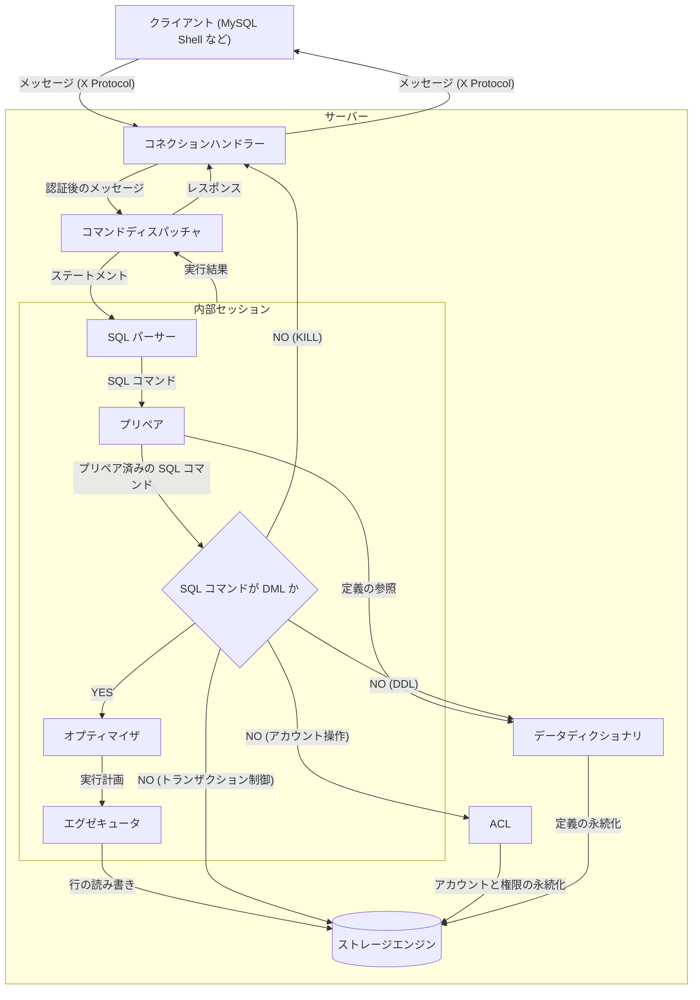

# MineSQL 仕様

## 全体像

## モジュール

| モジュール | 役割 | 仕様 |
| --- | --- | --- |
| プロトコル | クライアントとサーバーの間で交わすメッセージの形式や処理に関する規約を定める | [001_protocol/](./001_protocol/README.md) |
| コネクションハンドラー | 接続を受け付けて認証し、セッションの確立および切断をする | [002_connection/](./002_connection/README.md) |
| コマンドディスパッチャ | 認証済みのセッションが受け取ったリクエストを、種別ごとのリクエストハンドラに振り分ける | [003_dispatcher/](./003_dispatcher/README.md) |
| 内部セッション | 受け取ったステートメントを SQL パーサーで解析し、プリペアしてから実行する。 また、その実行に必要なセッションの状態を保持する | [004_session/](./004_session/README.md) |
| SQL パーサー | ステートメントを解析し、SQL コマンドを作る | [005_parser/](./005_parser/README.md) |
| データディクショナリ | スキーマ、テーブル、カラム、インデックスなどの定義を、ストレージエンジンに永続化する | [006_dictionary/](./006_dictionary/README.md) |
| ACL | アカウントと権限に関する情報をストレージエンジンに永続化する。 また、どのステートメントにどの権限が要るかを定める | [007_acl/](./007_acl/README.md) |
| プリペア | SQL コマンドを実行の前に検査し、名前や型などを解決する | [008_prepare/](./008_prepare/README.md) |
| オプティマイザ | ステートメントの実行計画を立てる | `009_optimizer/` |
| エグゼキュータ | 実行計画に沿ってクエリを実行する | `010_executor/` |
| ストレージエンジン | データを永続化し、トランザクション、ロック、ログなどを管理する | `011_storage/` |
