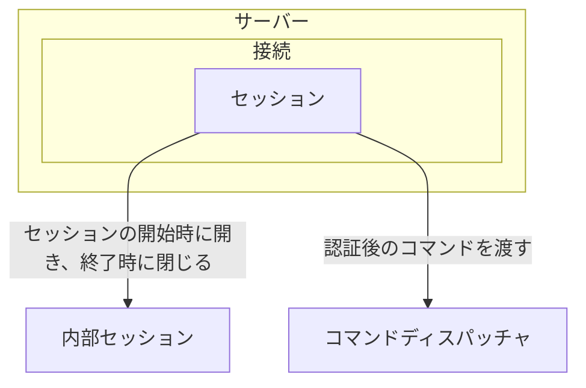
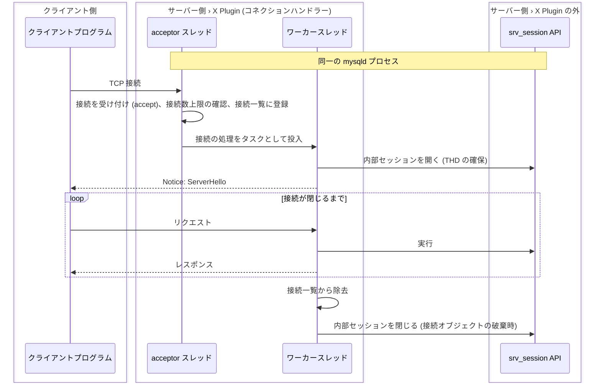
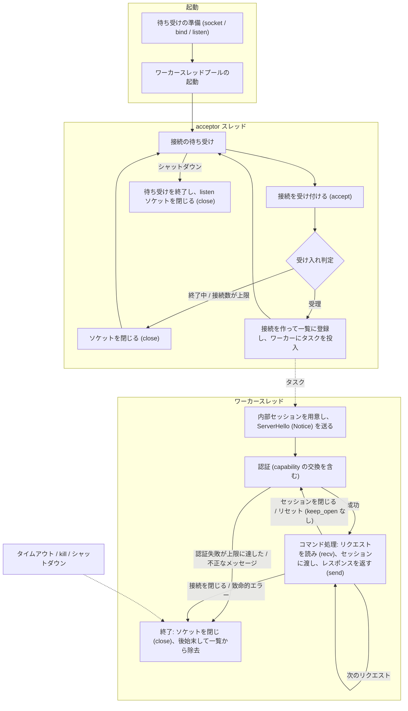
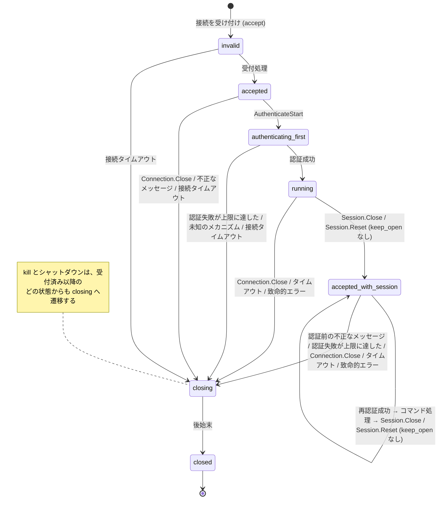

# コネクションハンドラー

- X Plugin のうち、接続の受付からセッションの確立・切断までを担う部分の仕様
- クライアントと直接やり取りする部分で、接続の受付、認証の進行、メッセージの読み書きなどを担う

## 責務

- listen ソケットの準備と接続の受付
- 接続数の上限管理
- 受け付けた接続へのワーカースレッドの割り当て (接続受付時にワーカースレッドプールから取り出し、切断後にプールに戻す)
- 接続の状態管理 (受付 → 認証 → 稼働 → 終了)
- 認証前に受け付けるメッセージの制限 (capability の取得と設定、認証、接続を閉じる要求だけを受け付け、他はエラーにして接続を閉じる)
- TLS への切り替え (capability `tls` を `true` に設定されたら、同じ接続を TLS にする)
- 接続に紐づくセッションの生成・再生成
- 認証 (認証メカニズムに沿った認証フローの進行、アカウント情報との照合など)
- タイムアウト監視 (接続確立・アイドル・読み取り・書き込み)
- 接続の強制切断 (kill、シャットダウン)
- 接続・セッション・スレッドに関する状態変数の更新

## 構成要素

コネクションハンドラーの振る舞いの主体となる構成要素は 3 つ

- サーバー: クライアントからの接続要求を受け入れるかどうかを決め、受け入れた接続の一覧を持つ
- 接続: フレームを読み書きし、接続の状態を管理する
- セッション: 認証を進め、認証後は認証したアカウントを実行ユーザーとしてコマンドをディスパッチャに渡す

### サーバー (Server)

- 接続を受け入れるかどうかを決め、受け入れた接続の一覧を管理する
  - この接続一覧は、接続数の上限の判定、kill、シャットダウン時の一斉通知に使う
- 起動から終了までの稼働状態を持ち、終了中は新しい接続を受け入れない

### 接続 (Client)

- サーバーが受け付けた接続 1 本につき 1 つ生まれ、X Plugin はこれを Client と呼ぶ
- バイト列をフレームとして読み書きし、接続の状態 (受付済み → 認証中 → 稼働中 → 終了) を管理する
- 認証前のメッセージは自分で処理し、認証後はセッションに渡す
- セッションを持ち、セッションが閉じられたら認証待ちの新しいセッションを作る
  - セッションを閉じても接続は残り、認証待ちの新しいセッションを伴って再認証を待つ

### セッション (Session)

- 接続の受付時に作られ、最初は認証中 (`authenticating`) の状態で、認証のメッセージだけを受け付ける
- 認証のやり取りを進め、成功すると認証したアカウントを内部セッションの実行ユーザーにして、コマンド受付中 (`ready`) の状態になる (メカニズムごとの処理は認証ハンドラに委ねる)
- 認証後は、受け取ったコマンドをコマンドディスパッチャに渡す
- どの種類の Notice を送るかの設定を持つ (管理コマンド `enable_notices` / `disable_notices` で変わり、コマンドディスパッチャがレスポンスを組み立てるときに参照する)
- 内部セッションを持ち、セッションの開始時に開き、終了時に閉じる
  - セッションは、クライアントとの認証のやり取りと、認証後のコマンドの受け渡しを担うプロトコル側の部分で、SQL は実行しない
  - 内部セッションは、ステートメントをパーサーで解析し、プリペアしてから実行するサーバー本体側の部分

## スレッドモデル

構成要素の処理を実行するスレッドは 2 種類ある

- acceptor スレッド
  - `network` という名前のスケジューラ (スレッドの集まり) が動かすタスクの 1 つで、listen ソケットのイベントループを回し、accept とタイマー (接続タイムアウトの監視、終了したワーカーの回収) を処理する
  - 同じスケジューラは、Notice を配る broker のタスクも別のスレッドで動かす
- ワーカースレッド (スケジューラ名 `work`)
  - 接続 1 本の処理全体 (受付後の初期化から切断まで) を 1 つのタスクとして実行する
    - タスクは接続が閉じるまで終わらないため、接続 1 本がワーカースレッド 1 本を接続中ずっと占有する (thread-per-connection)
    - スレッドは同時接続数に応じて増減するプールから割り当て、切断後のアイドルスレッドを次の接続に再利用する (classic protocol の thread cache と同じ役割)
    - したがって同時接続数の上限を決めるのは `mysqlx_max_connections` で、`mysqlx_min_worker_threads` はスレッド数の上限ではない

## 処理の流れ

起動から終了までの全体像

## 接続とセッションの状態遷移

- 接続 (Client) の状態
  - 生成直後 (`invalid`): acceptor スレッドが接続オブジェクトを作ってから、ワーカースレッドで受付処理が始まるまで
  - 受付済み (`accepted`): 受付処理が済み、capability の交換、認証の開始、接続を閉じるリクエストを受け付ける (セッションのリセットリクエストは無視する)
  - 初回認証中 (`authenticating_first`): 認証のやり取りをセッションに転送している
  - 稼働中 (`running`): 認証済みで、コマンドをセッションに渡す
  - セッション再生成後 (`accepted_with_session`): 一度セッションを閉じ、新しいセッションを用意した後の状態
    - 接続属性の設定と認証を受け付け、再認証が成功した後はコマンドも受け付ける
    - 再認証が成功しても接続の状態はこのままで、認証待ちか稼働中かはセッションの状態で判定される
    - 稼働中を前提にした処理 (アイドル中の kill の検知、kill / シャットダウン時の警告の Notice) は働かず、未認証の接続向けの接続タイムアウトの対象にもならない
  - 終了中 (`closing`) → 終了 (`closed`): ソケットを閉じ、後始末をして接続一覧から消える
- セッションの状態
  - 認証中 (`authenticating`): 認証メッセージだけを受け付ける
  - コマンド受付中 (`ready`)
  - 終了中 (`closing`)
- 状態を動かす出来事
  - クライアントからのメッセージ: 認証の開始と成功、セッションを閉じる / リセットする、接続を閉じる
  - サーバー側の判断: タイムアウト、kill、シャットダウン、致命的エラー
  - どの経路も最終的には終了中 (`closing`) の状態に至り、後始末は 1 箇所で行われる

## タイムアウトと上限の種類

コネクションハンドラーは以下を守る

- 接続確立の上限: 接続してから認証を終えるまでの時間に上限を設け、未認証の接続がスレッドを占有し続けるのを防ぐ
- アイドルの上限: 次のリクエストを待つ時間に上限を設け、放置された接続を回収する (対話的な接続には別の上限を使う)
- 読み書きの上限: 1 つのメッセージの読み取りと書き込みにかかる時間にそれぞれ上限を設け、途中で止まった接続を切る
- メッセージ長の上限: 過大なフレームを受け付けない
- 接続数の上限: 同時接続数が上限に達したら受け付けない

強制的に接続を閉じる経路は kill (管理コマンドまたは `KILL` ステートメントによる他の接続の切断、または自分自身の切断) とサーバーのシャットダウンの 2 つで、いずれの場合も状態を終了中 (`closing`) へ遷移する

## 参考資料

- [WL#8338: X Plugin](https://dev.mysql.com/worklog/task/?id=8338)
- [MySQL Connection Handling and Scaling](https://dev.mysql.com/blog-archive/mysql-connection-handling-and-scaling/)
- [MySQL 8.4 Reference Manual: Connection Interfaces](https://dev.mysql.com/doc/refman/8.4/en/connection-interfaces.html)
- [MySQL 8.4 Reference Manual: X Plugin](https://dev.mysql.com/doc/refman/8.4/en/x-plugin.html)
