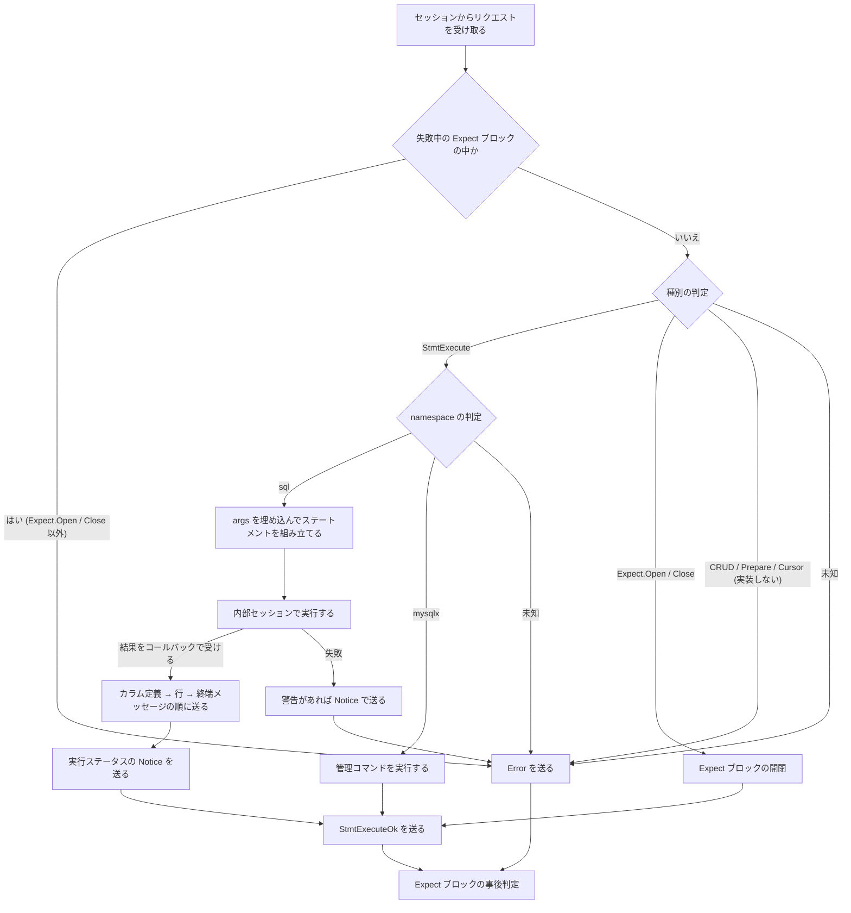

# コマンドディスパッチャ (X Plugin)

- 認証済みのセッションが受け取ったリクエストを、種別ごとのハンドラに振り分ける部分の仕様
- 内部セッションに実行を依頼し、レスポンスを送り返す

## 責務

### 担うこと

- リクエストメッセージの種別の判定をし、種別に応じて適切なハンドラへリクエストを振り分ける
- `StmtExecute` の namespace (`sql` / `mysqlx`) の解決をし、パラメータ (`args`) を埋め込んだステートメントを組み立てる
- 内部セッションへ ... の実行を委譲し、その実行結果を受け取る
- 受け取った結果をプロトコルのメッセージにして、できた順に送る
- 実行ステータス (Affected Rows、Last Insert ID、サーバーからのメッセージ、警告) を Notice としての送出する
- 1 つのリクエストに対するレスポンスの列の終端メッセージ (`StmtExecuteOk` または `Error`) を送出する
- エラーの深刻度を決定する (シーケンスだけを中断する `ERROR` と、接続を閉じる `FATAL`)
- Expect ブロックによる、パイプラインされたリクエストを実行する
- 未知の種別、未知の namespace、未知の管理コマンドに対するレスポンスを返す
- 実行に関する状態変数の更新をする

### 担わないこと

- ドキュメントモデル (CRUD メッセージ、コレクション系の管理コマンド) と、プロトコルのプリペアドステートメント・カーソル
  - 実装しないため、未対応のメッセージとしてエラーを返す

## 構成要素

いずれもセッションに属し、セッションとライフサイクルを共有する

- 仕組み
  - ディスパッチャ (Dispatcher): リクエストを受け取り、Expect ブロックの判定を挟んでハンドラへ渡し、失敗したら `Error` を送る
  - ハンドラ: リクエストの種別ごとに 1 つあり、その種別のリクエストを処理する
    - SQL ステートメントの処理: `StmtExecute` を受け、namespace に応じて SQL の実行か管理コマンドの実行に分ける
    - 管理コマンドの処理: コマンド名を引き、引数を検証して実行する
    - Expect ブロックの処理: `Expect.Open` / `Expect.Close` でブロックを開閉する
  - 内部セッション: ステートメントの実行を依頼し、結果をコールバックで受け取る先
  - デリゲート: 実行 1 回につき 1 つ作られ、内部セッションからのコールバック (カラム定義、行、完了、エラー) を受けてプロトコルのメッセージに変換して送る
  - Expect スタック: 開いている Expect ブロックの入れ子
- MineSQL での仕様
  - 内部セッションへはステートメントの文字列をそのまま渡し、classic のコマンド (`COM_QUERY`) への変換を挟まない

## 実行モデル

- 1 セッションでは、ワーカースレッドが同時に 1 つのリクエストだけを処理する
  - 先に届いたリクエストは受信側で待ち、前のレスポンスを送り終えてから順に処理する
  - だからレスポンスの順はリクエストの順と同じになる
  - パイプライン化で減るのは往復の待ちで、処理が並列になるわけではない
- 結果は溜め込まずに流す
  - カラム定義は全カラムが揃った時点でまとめて送り、行は 1 行できるたびに送る
  - 長いリザルトセットの送信中も、行を送るたびに接続の生存と kill を確認する
- 警告だけは実行が終わるまで取り出せないので、警告があるときは実行ステータスの Notice と終端メッセージを実行後にまとめて送る

## 処理の流れ

リクエストを 1 つ受け取ってから終端メッセージを送るまでの流れ

## ディスパッチャが保証する規則

メッセージのやり取りの規則を、サーバーが守る側から書いたもの

- 1 つのリクエストには必ず 1 つの終端メッセージを返す (`StmtExecuteOk` または `Error`)
  - リクエストが失敗した場合も、Expect ブロックで拒否された場合も、終端メッセージは `Error` になる
- レスポンスの列はリクエストの順に返す (同時に 1 リクエストしか処理しないため自然に成り立つ)
- リザルトセットのカラム定義、行、取得完了メッセージ (`FetchDone`)、Notice、終端メッセージはプロトコルの規則の順に送る
  - 警告の Notice はリザルトセットの後、実行ステータスの Notice の前にまとめて送る
- エラーの深刻度
  - SQL の実行エラー、未知の種別、未知の namespace、管理コマンドの引数エラー、Expect ブロックの失敗は `ERROR` で、セッションは継続する
  - 実行中に内部セッションが KILL された場合と、内部セッションとの連携そのものに失敗した場合は `FATAL` で、セッションを閉じる

## Expect ブロック

- 仕組み
  - 目的: パイプラインで送ったリクエストのうち、先行するリクエストが失敗したら後続を実行せずに失敗させる
    - これにより、クライアントはレスポンスを待たずに依存関係のあるリクエストを送れる
  - ブロックはセッションごとのスタックで管理され、入れ子にできる
    - 内側のブロックは既定で外側の条件を引き継ぐ
  - 条件 `no_error` を持つブロック内でリクエストが失敗すると、そのブロックは失敗状態になる
    - 以後は `Expect.Close` までのすべてのリクエストと `Close` 自身が `Error` になる
  - 条件を持たないブロックは失敗を吸収し、外側の `no_error` ブロックまで失敗を伝えない
- MineSQL での仕様
  - 実装する条件は `no_error` のみ

## 管理コマンド

- 仕組み
  - `StmtExecute` の namespace `mysqlx` で、SQL ではなくコマンド名と名前付き引数を送る経路
  - レスポンスは SQL ステートメントと同じ形 (リザルトセットがあればカラム定義 → 行 → 取得完了メッセージ、最後に終端メッセージ) で返す
  - `list_clients` と `kill_client` の対象は、`SUPER` を持つアカウントなら全ての接続、それ以外は同じアカウントの接続に限られる
  - `kill_client` は、対象が自分自身の接続なら直接閉じ、他の接続なら要求元の内部セッションで `KILL` ステートメントを実行してから閉じる
- MineSQL での仕様
  - 実装するのは接続と Notice に関する 6 つ: `ping`、`list_clients`、`kill_client`、`enable_notices`、`disable_notices`、`list_notices`
  - `SUPER` に相当する権限を持たないため、`list_clients` と `kill_client` の対象は常に同じアカウントの接続だけ
