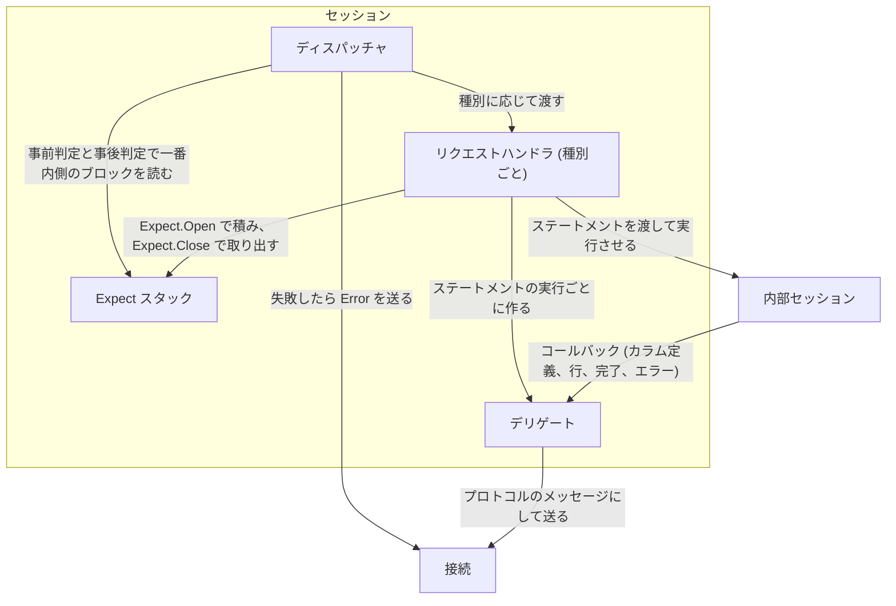
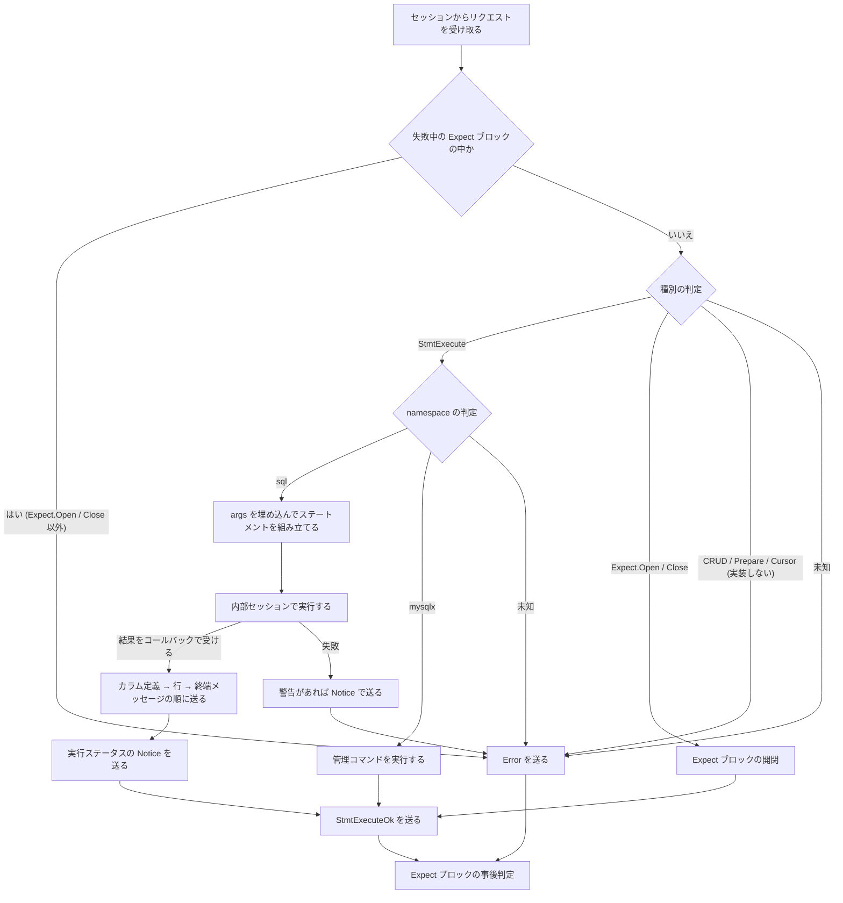

# コマンドディスパッチャ (X Plugin)

- 認証済みのセッションが受け取ったリクエストを、種別ごとのリクエストハンドラに振り分ける部分の仕様
- 内部セッションに実行を依頼し、レスポンスを送り返す

## 責務

### 担うこと

- リクエストメッセージの種別の判定をし、種別に応じて適切なリクエストハンドラへリクエストを振り分ける
- `StmtExecute` の namespace (`sql` / `mysqlx`) の解決をし、パラメータ (`args`) を埋め込んだステートメントを組み立てる
- 組み立てたステートメントを内部セッションに渡して実行させ、その結果 (カラム定義、行、実行ステータス、エラー など) を受け取る
- 受け取った結果をプロトコルのメッセージにして、できた順に送る
- 実行ステータス (Affected Rows、Last Insert ID、サーバーからのメッセージ、警告) を Notice としての送出する
- 1 つのリクエストに対するレスポンスの列の終端メッセージ (`StmtExecuteOk` または `Error`) を送出する
- エラーの深刻度を決定する (シーケンスだけを中断する `ERROR` と、接続を閉じる `FATAL`)
- Expect ブロックによる、パイプラインされたリクエストを実行する
- 未知の種別、未知の namespace、未知の管理コマンドに対するレスポンスを返す
- 実行に関する状態変数の更新をする

### 担わないこと

- ドキュメントモデルのリクエストの処理
  - CRUD メッセージ (`Find` / `Insert` / `Update` / `Delete`、ビュー操作) を SQL に変換して実行すること
  - コレクション系の管理コマンド (`create_collection` など) の実行
- プロトコルのプリペアドステートメントとカーソルのリクエストの処理
  - `Prepare` / `Execute` / `Deallocate` と `Cursor.Open` / `Fetch` / `Close` を受けて、ステートメントの識別子とカーソルを管理すること

上記はいずれも実装しないため、これらのメッセージには未対応としてエラーを返す

## 構成要素

以下はいずれもセッションが持つ

- ディスパッチャ (Dispatcher): リクエストを受け取り、Expect ブロックの判定を挟んでリクエストハンドラへ渡し、失敗したら `Error` を送る
  - 事前判定: リクエストを処理する前に、一番内側の Expect ブロック (スタックの先頭) を見て、失敗状態なら実行せずに `Error` を返す
  - 事後判定: リクエストがエラーになったら、一番内側の Expect ブロック (スタックの先頭) が `no_error` を持っていれば、そのブロックを失敗状態にする
    - `no_error` を持っていなければ何もしない
- リクエストハンドラ: リクエストの種別 (`StmtExecute`、`Expect.Open` / `Expect.Close` など) に対応していて、その種別のリクエストを処理する
  - `StmtExecute` の処理: namespace に応じて分ける
    - `sql` なら、`args` を埋め込んだステートメントを内部セッションで実行する
    - `mysqlx` なら、コマンド名に対応する管理コマンドを一覧から探し、引数を検証して実行する
  - `Expect.Open` / `Expect.Close` の処理: `Open` で Expect ブロックを 1 つスタックに積み、`Close` で一番内側の Expect ブロック (スタックの先頭) を取り出す
- デリゲート: ステートメントを 1 つ実行するたびに作られ、内部セッションからのコールバック (カラム定義、行、完了、エラー など) を受け、それをプロトコルのメッセージに変換して送る
  - 内部セッションは結果を値として返さず、行ができるたびに「結果を送るためのコンポーネント」(MySQL だと `Protocol`) に渡す設計になっており、X Protocol においては、デリゲートがその役を担う
  - このようにすることで結果を溜めずに流せ、「何を実行するか」(リクエストハンドラ) と「結果をどう送るか」(デリゲート) を分けられる
- Expect スタック: 開いている Expect ブロックを、入れ子の順に積んだもの
  - 積まれている各ブロックが、条件 (`no_error` を持つかどうか) と、失敗状態かどうかを持つ
  - `Expect.Open` / `Expect.Close` のリクエストハンドラが積み下ろしし、ディスパッチャが事前判定と事後判定で一番内側のブロックを読む

## 実行モデル

- 1 セッションでは、ワーカースレッドが同時に 1 つのリクエストだけを処理する
  - 続けて届いたリクエストは、読み出されるまで接続の受信バッファに残り、ワーカースレッドは前のレスポンスを送り終えてから次のフレームを読み出して処理する
  - よってレスポンスの順はリクエストの順と同じになる
  - パイプライン化で減るのは往復の待ちで、処理が並列になるわけではない
- 結果は溜め込まずに流す
  - カラム定義は全カラムが揃った時点でまとめて送り、行は 1 行できるたびに送る
  - 長いリザルトセットの送信中も、行を送るたびに接続がまだ使えるか (クライアントが切断していないか、kill やシャットダウンで止められていないか) を確認する
- 警告 (e.g. 文字列を数値に変換できず 0 として扱った、値を切り詰めた) は、内部セッションがステートメントを実行する間に、内部セッションの診断領域 (`diagnostics_area`) に溜まり、実行が終わった後にしか取り出せない
  - 警告がなければ、内部セッションから完了のコールバックを受けた時点で、実行ステータスの Notice と終端メッセージをすぐ送る
  - 警告があれば (完了のコールバックが警告の数を伝え)、診断領域から警告を取り出して Notice で送ってから、実行ステータスの Notice と終端メッセージを送る\
    (順序の規則: 警告 → 実行ステータス → 終端メッセージ)

## 処理の流れ

リクエストを 1 つ受け取ってから終端メッセージを送るまでの流れ

## ディスパッチャが保証する規則

メッセージのやり取りの規則を、サーバーが守る側から書いたもの

- 1 つのリクエストには必ず 1 つの終端メッセージを返す (`StmtExecuteOk` または `Error`)
  - リクエストが失敗した場合も、Expect ブロックで拒否された場合も、終端メッセージは `Error` になる
- レスポンスの列はリクエストの順に返す (同時に 1 リクエストしか処理しないため自然に成り立つ)
- リザルトセットのカラム定義、行、取得完了メッセージ (`FetchDone`)、Notice、終端メッセージはプロトコルの規則の順に送る
  - 警告の Notice はリザルトセットの後、実行ステータスの Notice の前にまとめて送る
- エラーの深刻度
  - SQL の実行エラー、未知の種別、未知の namespace、管理コマンドの引数エラー、Expect ブロックの失敗は `ERROR` で、セッションは継続する
  - 実行中に内部セッションが KILL された場合と、内部セッションとの連携そのものに失敗した場合は `FATAL` で、セッションを閉じる

## Expect ブロック

- 仕組み
  - 目的: パイプラインで送ったリクエストのうち、先行するリクエストが失敗したら後続を実行せずに失敗させる
    - これにより、クライアントはレスポンスを待たずに依存関係のあるリクエストを送れる
  - ブロックはセッションごとのスタックで管理され、入れ子にできる
    - 内側のブロックは既定で外側の条件を引き継ぐ
  - 条件 `no_error` を持つブロック内でリクエストが失敗すると、そのブロックは失敗状態になる
    - 以後は `Expect.Close` までのすべてのリクエストと `Close` 自身が `Error` になる
  - 条件を持たないブロックは失敗を吸収し、外側の `no_error` ブロックまで失敗を伝えない
- MineSQL での仕様
  - 実装する条件は `no_error` のみ

## 管理コマンド

- 仕組み
  - `StmtExecute` の namespace `mysqlx` で、SQL ではなくコマンド名と名前付き引数を送る経路
  - レスポンスは SQL ステートメントと同じ形 (リザルトセットがあればカラム定義 → 行 → 取得完了メッセージ、最後に終端メッセージ) で返す
  - `list_clients` と `kill_client` の対象は、`SUPER` を持つアカウントなら全ての接続、それ以外は同じアカウントの接続に限られる
  - `kill_client` は、対象が自分自身の接続なら直接閉じ、他の接続なら要求元の内部セッションで `KILL` ステートメントを実行してから閉じる
- MineSQL での仕様
  - 実装するのは接続と Notice に関する 6 つ: `ping`、`list_clients`、`kill_client`、`enable_notices`、`disable_notices`、`list_notices`
  - `SUPER` に相当する権限を持たないため、`list_clients` と `kill_client` の対象は常に同じアカウントの接続だけ
